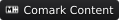

# Config Variants

<p>
  <a href="https://github.com/happydesigns/config-variants/actions/workflows/ci.yml?query=branch%3Amain+event%3Apush">
    
  </a>
  <a href="LICENSE"></a>
  <a href="docs/content/docs/10.platform-preview.md#portable-core"></a>
  <a href="docs/content/docs/1.getting-started.md"></a>
  <a href="docs/content/docs/10.platform-preview.md#comark-content"></a>
</p>

Define and resolve named, typed configurations from reusable features and defaults. A data record, a route, or application code selects the variant. For example, articles and events can share a hero and breadcrumbs while defining different fields and layout behavior.

## Nuxt quickstart

Install the published package with `pnpm add @happydesigns/config-variants`. To try an unpublished build, install the archive produced by [the repository's package check](CONTRIBUTING.md#release-workflow).

```ts
// nuxt.config.ts
export default defineNuxtConfig({
  modules: ["@happydesigns/config-variants"],
  variants: {
    registry: {
      hero: { config: { heroAlign: "left" } },
      article: { extends: "hero" },
      event: { extends: "hero", config: { heroAlign: "center" } },
    },
  },
});
```

```ts
// app/pages/events.vue
definePageMeta({ variant: "event" });
const { config } = useVariant("event");
// config.value.heroAlign is "center".
```

Nuxt resolves the package name in `modules` to the `/nuxt` entry point. The [Nuxt guide](docs/content/docs/1.getting-started.md) shows how to select a variant in a shared layout and override values with `app.config.ts`. The Config Variants tab in Nuxt DevTools traces resolved values to their source.

## Integrations

| Entry point | Use |
| --- | --- |
| `@happydesigns/config-variants` | [Resolve variants in TypeScript](docs/content/docs/10.platform-preview.md#portable-core). |
| `/nuxt` | [Use reactive config and generated types in Nuxt](docs/content/docs/3.api.md). |
| `/schemas` | [Compose Nuxt Content collection schemas](docs/content/docs/5.content-schemas.md). |
| `/comark-content` | [Validate and store variant selections in Comark Content](docs/content/docs/10.platform-preview.md#comark-content). |
| `/devtools` | [Host the DevFrame inspector](docs/content/docs/10.platform-preview.md#standalone-inspector). |

See the [migration guide](docs/content/docs/9.migration-0-3.md) when upgrading from `@happydesigns/nuxt-variants`.

## Development

Use the Node.js and pnpm versions declared in [`package.json`](package.json).

```bash
pnpm install --frozen-lockfile
pnpm dev
```

Open **Editorial documents** in the playground to see Comark Content select `article` or `event` from Markdown frontmatter. Run `pnpm docs` for the documentation site and `pnpm check` for lint, type checks, and tests.

See [Contributing](CONTRIBUTING.md) for the package and release checks, [Architecture](ARCHITECTURE.md) for the system boundaries, and the [comparison guide](docs/content/docs/10.platform-preview.md#compare-and-verify) for the side-by-side inspector. The [Course pilot](docs/course-pilot.md) covers a real upgrade and rollback.
